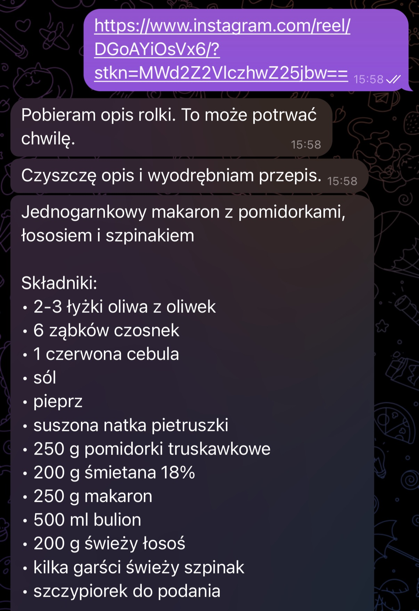

## Developing a bot.

**Main project phases:**

- Creating a Telegram bot. The bot receives a message containing a link to a Reel. :white_check_mark:
- Running the bot program in Python. The local program listens for Telegram messages and responds to a link. :white_check_mark:
- Retrieving Reel data from Instagram via Apify. The bot sends a link to Apify and receives the description and available Reel metadata. :white_check_mark:
- Extracting specific text using the OpenAI model. Completed locally: Structured fields are generated from the description. :white_check_mark:

- Bot update: instead of sending the draft via Telegram, it saves a record in the database Next up. After analyzing the data, the bot will send it to Worker and reply briefly, e.g., “Recipe saved” or “Needs more details.” :x:
- Creating a web app to browse the database. :x:
- Manually filling in missing and necessary information. Once all information is complete, the record’s status will change to “ready.” :x:
- Future Development Options: Audio transcription, automatic thumbnail download, search function, tags and launching Telegram via a webhook—without having to turn on your computer. :x:

**I abandoned this project because it turned out there are apps that do exactly what I wanted to achieve. I'm not going to reinvent the wheel, so I'll focus on my other projects :)**
